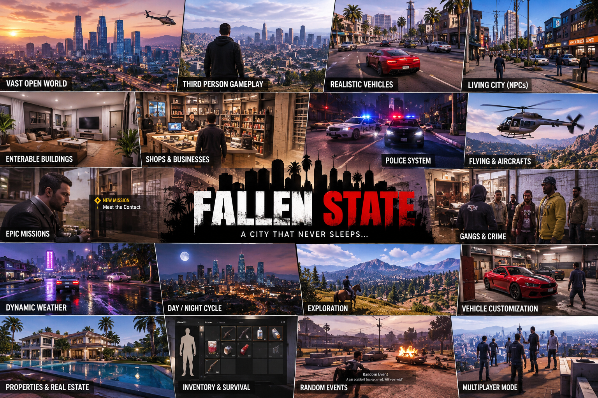

# FALLEN STATE

**"A city that never sleeps."**

Ek third-person open-world action game — Godot 4 me. Yeh repo sirf idea nahi hai:
isme **chalne wala playable prototype** + **poora development plan** dono hain.



---

## Abhi kya ban chuka hai (playable, 2 minute me chal jayega)

| System | Status |
|---|---|
| 3rd person player (walk / sprint / jump / mouse camera) | ✅ |
| Arcade driving + enter/exit vehicle (4 cars) | ✅ |
| Procedural city district (4×4 blocks, roads, buildings, park, streetlights) | ✅ |
| **Enterable building** — Corner Store with working door + shop UI | ✅ |
| 16 NPCs — daily routine (time-based), danger reaction | ✅ |
| Day/night cycle + sun/sky/fog/ambient lighting | ✅ |
| Money / shop economy + police heat meter | ✅ |
| 3-step mission chain + in-world objective marker | ✅ |
| Random world event (road accident, help ya ignore karo) | ✅ |
| Save / load (F5 / F9, JSON) | ✅ |
| HUD (clock, money, heat, objective, prompts, toasts) | ✅ |

Sab kuch **GDScript code se banaya gaya hai** — koi external asset, koi .blend file
nahi chahiye. Isliye yeh 100% tumhare system par chalega.

---

## Start kaise karein (3 step)

1. **[godotengine.org/download](https://godotengine.org/download)** se **Godot 4.4+** (standard, non-.NET) download karo. Zip extract karo, install jaisa kuch nahi chahiye.
2. Godot kholo → **Import** → **Browse** → is folder ka `project.godot` choose karo → **Import & Edit**.
3. Upar-right me ▶ (Run) dabao. Bas.

> Pehli baar me Godot 30-60 second lagayega (import + script cache). Uske baad instant.

---

## Controls

| Key | Kaam |
|---|---|
| `W A S D` | chalna / gaadi chalaana |
| `Shift` | daudna / gaadi tez |
| `Space` | jump (only on foot) |
| `Mouse` | camera |
| `E` | interact (shop counter, accident help) |
| `F` | gaadi me baitho / utro |
| `H` | horn (gaadi me) |
| `F5` / `F9` | save / load |
| `Esc` | mouse free karo (Godot editor me wapas jaane ke liye) |

**Pehla kaam jo karna hai:** game me ghumo, phir `scripts/world/main.gd` kholo
aur `NPC_COUNT = 16` ko `40` kar do. Difference feel karo. Yahi tuning loop hai.

---

## Folder structure

```
project.godot              # engine settings (renderer, autoload)
scenes/                    # 4 chhoti scenes (main, player, car, npc)
scripts/
  core/game.gd             # AUTOLOAD: money, time, heat, flags, save/load, keys
  world/main.gd            # assembly: lighting -> world -> player -> HUD -> missions
  world/world_builder.gd   # procedurally district banata hai
  world/day_night.gd       # 24h clock + sun + sky + fog
  world/shop_counter.gd    # enterable building ka interaction + UI
  player/player.gd         # 3rd person controller + vehicle hook
  vehicles/car.gd          # arcade driving
  npc/npc.gd               # routine + reaction AI
  systems/mission_system.gd
  systems/world_events.gd
  systems/incident.gd
  ui/hud.gd
docs/
  00-KYA-KARNA-HAI.md      # ⭐ pehle yeh padho — engine, plan, tools, galtiyan
  ROADMAP.md               # M0 -> M10 milestones, 12 mahine ka plan
  TECH-NOTES.md            # architecture + "naya feature kaise add karein"
  art/key-art.png
```

---

## Documentation

- **[docs/00-KYA-KARNA-HAI.md](docs/00-KYA-KARNA-HAI.md)** — Godot vs Unity, kya use karna hai, 30 din ka plan, 10 galtiyan
- **[docs/ROADMAP.md](docs/ROADMAP.md)** — milestone-by-milestone, "kab kya banega"
- **[docs/TECH-NOTES.md](docs/TECH-NOTES.md)** — code kahan hai, naya system kaise jodein

---

## License note (important)

Is repo me `LICENSE` **AGPL-3.0** hai. AGPL ka matlab: agar tum game release karo,
toh **source code public karna padega**. Commercial game bechna hai to license
**MIT / proprietary** me badalna hoga (Godot engine khud MIT hai, usme koi dikkat
nahi). `docs/00-KYA-KARNA-HAI.md` me iska detail hai.
